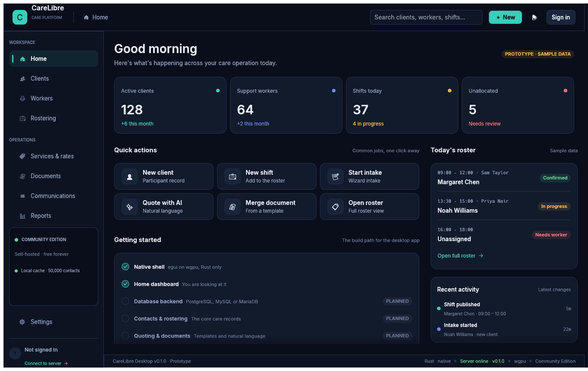
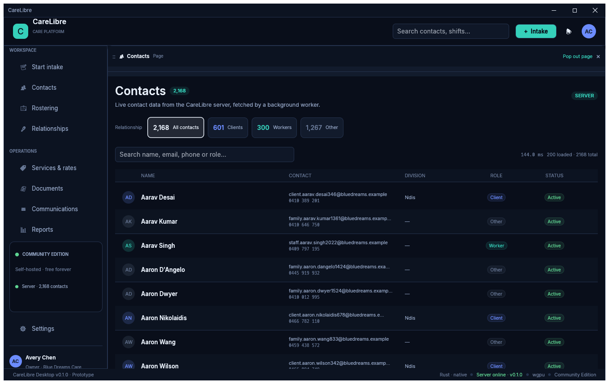
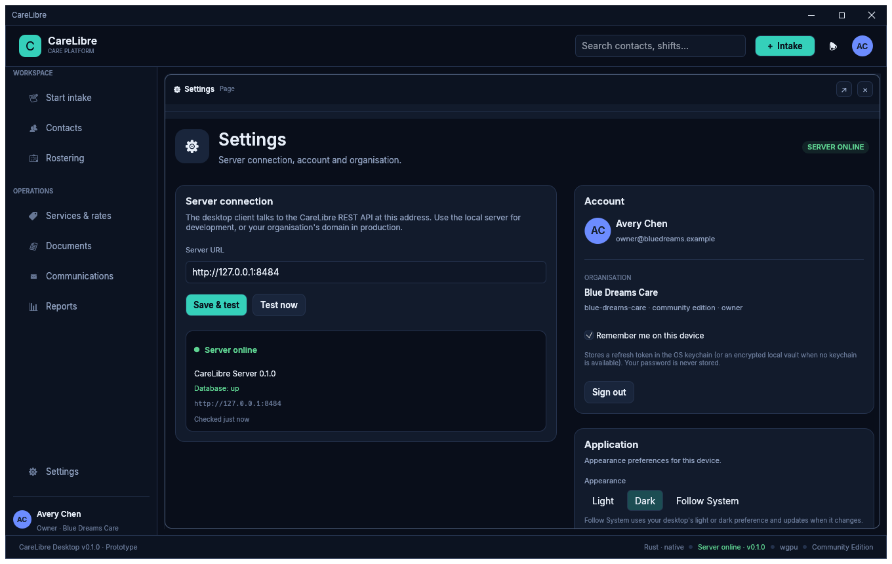
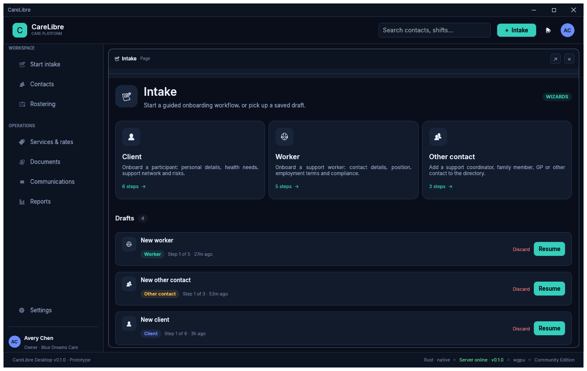
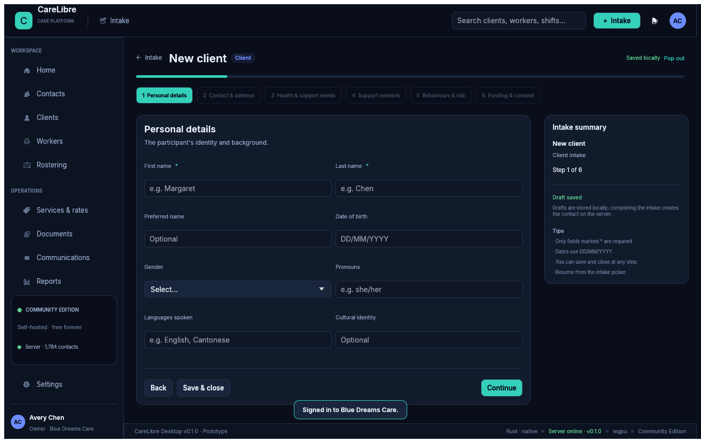
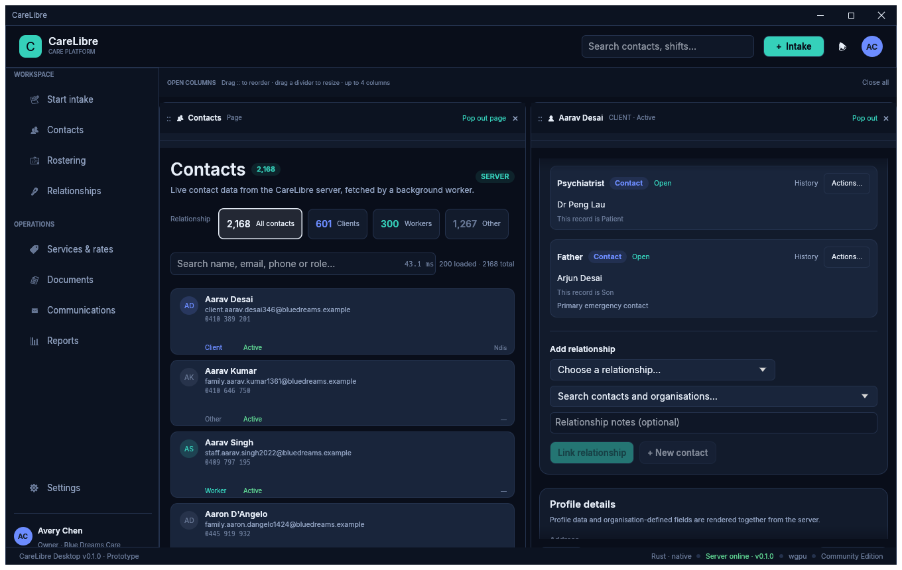
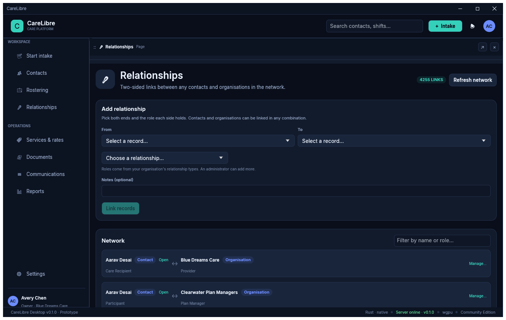
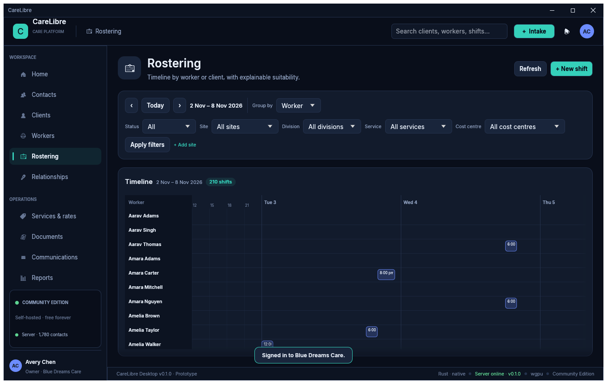
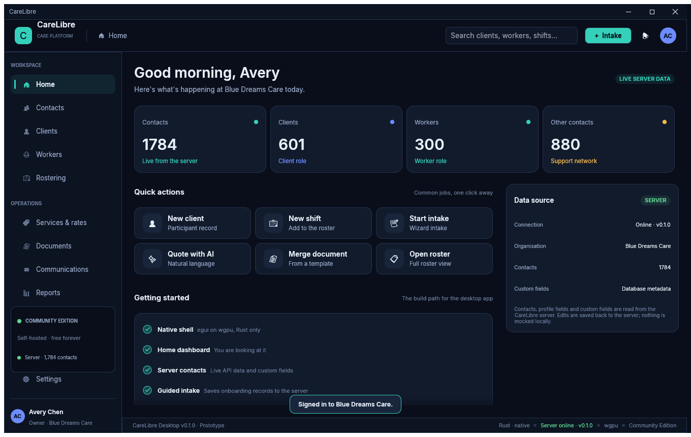

# CareLibre Desktop

A fast, native desktop client for [CareLibre](https://github.com/IanHead/CareLibre), the
open-source care management platform for disability and aged care providers.

> **Status: prototype.** The native application shell, home dashboard and server
> authentication are in place. Contacts, clients and workers are read live from the
> CareLibre server through a background worker and displayed in virtualised, paged lists.
> Every contact opens in the right-hand record dock, where several records can stay open as
> draggable tabs — each can be reordered, closed or popped out into a native free-floating
> window. Edits, custom-field values and linked relationships are saved back to the server.
> Guided intake wizards persist drafts locally and create onboarding contacts on the server.
> Rostering, services, documents and communications are next.



















## Design principles

- **Performance is the feature.** The desktop client is designed to be as fast as
  possible: every list is virtualised, API calls run on background workers, the UI thread
  never blocks on the network or SQLite, and no screen waits on a spinner. Contacts are
  fetched directly from the server today; the local-first cache and delta-sync plan for
  large rosters is in [`docs/performance-architecture.md`](docs/performance-architecture.md).
- **Native, not a web page in a trench coat.** Rust, [egui](https://github.com/emilk/egui)
  and wgpu. No Electron, no embedded web view, no JavaScript. A client-side title bar is
  the default for new installs; native OS window decorations can be selected in Settings.
- **Cross-platform.** Windows, macOS and Linux from one codebase.
- **GPU first, CPU fallback.** wgpu selects Vulkan, Metal, DX12 or OpenGL at runtime and
  can fall back to software adapters (for example lavapipe or llvmpipe) on machines
  without a usable GPU.
- **Neat by default, multitasking on demand.** Contact records open in a right-hand dock;
  keep as many open as you need as reorderable tabs, and pop any record or wizard into an
  independent native OS window that can be moved, resized and kept alongside the app.
- **Delightful, GPU-rendered motion.** Page transitions, dock and tab states, navigation
  hover and toast notifications animate on the wgpu-rendered UI at display refresh rate.
- **Relationships are first class.** The server stores two-sided links with a role for
  each endpoint, and any contact can be connected to any other contact or organisation.
  The desktop reads the relationship graph so pickers search the whole network.
- **Open source, self-hostable.** Community Edition is free forever. Business and
  Enterprise editions add support, consulting and managed deployment.

## Running it

### Prerequisites

- [Rust](https://rustup.rs) 1.95 or newer
- A C linker / build toolchain:
  - **Linux:** `build-essential` (or equivalent)
  - **macOS:** Xcode Command Line Tools
  - **Windows:** MSVC Build Tools

On Linux you also need an X11 or Wayland session and a graphics driver offering Vulkan
or OpenGL. On Debian/Ubuntu the runtime packages are typically:

```sh
sudo apt install libxkbcommon0 libwayland-client0 libx11-6 libvulkan1
```

### Build and run

```sh
git clone https://github.com/IanHead/CareLibre-Desktop.git
cd CareLibre-Desktop
cargo run --release
```

For development builds with fast incremental compiles:

```sh
cargo run
```

## Connecting to the server

The client talks to the CareLibre Server REST API. A local development server listens
on `http://127.0.0.1:8484` by default.

Open **Settings** in the sidebar to:

- change the server URL (saved to the platform config directory)
- check liveness and database readiness (`/healthz` and `/readyz`)
- sign in, or create the first organisation with an owner account
- sign out and inspect the active organisation and edition
- choose Light, Dark or Follow System appearance (Follow System by default)
- choose client-side or native window decorations
- remember your sign-in securely on this device

The connection is checked every 15 seconds and the status is shown in the status bar.
Signing in is required for all contact data and intake completion: the desktop no longer
uses mock contacts. Access tokens are refreshed automatically. Enable **Remember me on this device** to
persist the rotating refresh token: it is stored in the OS keychain (Windows Credential
Manager, macOS Keychain or Secret Service) or, when no keychain is available, in a local
vault encrypted with a machine-bound key. Passwords are never stored. Signing out removes
the saved token.

For local development, the server repository ships a demo seed (Blue Dreams Care) with
1,700+ contacts and custom fields:

```sh
cd ../CareLibre
make seed-demo
# owner@bluedreams.example / BlueDreamsCare!2026
```

### Live integration tests

With a server running, exercise the real connection path:

```sh
cargo test --test server_live -- --ignored
```

Set `CARELIBRE_TEST_SERVER=https://care.example.com` to target another instance.

## Intake and onboarding

The **Intake** button in the top bar opens a scenario picker for:

- **Client intake** — identity, contact and address, health and support needs, emergency
  and professional contacts, behaviours and risk, funding and consent.
- **Worker intake** — identity and contact details, position and division, employment
  terms, award classification, compliance checks and expiry dates.
- **Other contact intake** — coordinators, family, GPs and other support-network contacts.

Wizards save drafts automatically to the local SQLite cache, can be closed and resumed from
the picker, and create the contact on the server when completed. Use **Pop out** at the top
right to work on an intake in its own native window; **Dock** brings it back to the page. Core fields are sent as
contact columns; the rest of the intake data is stored in the contact's server-side
`details` JSON. Completed records appear immediately in the server-backed Contacts list.

## Contact records and custom fields

Click any row in Contacts, Clients or Workers to open the contact editor in the right-hand
record dock. Open as many records as you like: they appear as tabs above the editor and can
be reordered by dragging, closed with **×**, or detached into an independent native OS
window with **Pop out**; **Dock** brings a popped-out record back into the tab strip. Tabs
stay in place while you navigate the rest of the app.

The editor loads the contact, its extended `details` profile and every active custom-field
definition from the server. Nothing is hardcoded in the UI:

- **Stock fields** are the server's contact columns: display name, given/family/preferred
  name, pronouns, date of birth, email, phone, notes, role and status.
- **Custom fields are metadata.** Definitions live in the server's
  `custom_field_definitions` table and values in `custom_field_values`. The editor renders
  them with the same labels and inputs as stock fields, in the same form — they are not
  grouped into a separate custom-fields section. A field created in the server admin panel
  appears automatically on the next contact open.
- Profile JSON from intake is rendered as editable fields alongside the stock record.
- Saving sends a `PATCH /api/v1/contacts/{id}` request and refreshes the server-backed list.

### Relationships

The editor's **Relationships** card links records instead of retyping their details. Pick a
relationship such as **Emergency Contact**, **Next of Kin** or **Support Coordinator**, then
search the relationship graph by name and select the record — contacts and organisations are
both listed. Linked records can be opened in their own dock tab with **Open**.

If the person is not on file yet, choose **+ New contact**, enter their core details and
press **Create & link**. The contact is created on the server and linked immediately — no
reload is needed, and the new record is selectable from every relationship lookup straight
away.

Relationships are read and written through the server's graph API
(`/api/v1/relationships`, `/api/v1/relationships/graph`). Every link is two-sided: the
server stores a role for each endpoint (`person_supported` / `emergency_contact`,
`patient` / `general_practitioner`, and so on), and the editor shows both sides. Pickers
search the whole graph, so both contacts and organisations are selectable and links can be
removed without touching either record.

The **Relationships** workspace page manages the network directly. Choose any two records —
contact or organisation — give each side a role, and link them. It lists and filters every
link in the tenant and supports deleting them.

## Rostering and worker suitability

The **Rostering** workspace draws the week as a **timeline grouped by worker or client**,
with a resource column fixed on the left while the hours scroll. Filter by week, status,
site, division, service and cost centre. Select a shift block for its assignments and
suitability.

Create or edit shifts with their kind, local start/end time, site, location and status.
New shifts can repeat **daily, weekly or fortnightly** (a count or an until date); the client
computes occurrences in local wall time and submits them as one atomic series. **Copy** a
shift and **Paste** it on another date, optionally copying its client and worker assignments.
Delete a shift with a confirmation, and update attendance (`assigned`, `attended`,
`no_show`, `cancelled`), worker outcomes and 1–5 ratings. Sites can be added from the same
page.

**Worker suitability** is advisory and explainable. The server scores candidates from
observed history and explicit constraints, then returns the evidence behind each score —
for example “2 attended shifts at site Blue Dreams Day Program” or “preferred for Personal
care: Regular program lead”. Hard `blocked` constraints are listed separately with their
reasons, and the coordinator decides; nothing is auto-assigned. See the server's
[ADR 0011](https://github.com/IanHead/CareLibre-Server/blob/main/docs/adr/0011-rostering-suitability-graph.md)
for the evidence model.

## Appearance, window decorations and sign-in

CareLibre adapts to the desktop's light or dark appearance by default. **Settings →
Application** offers **Light**, **Dark** and **Follow System**; Follow System is the
default and updates live when the desktop switches. On Linux the current preference comes
from the freedesktop settings portal, with `GTK_THEME` and `gsettings` fallbacks; Windows
and macOS use the native window theme. Both palettes are tuned to the same layout, so every
screen, card, table and pop-out window switches cleanly.

New installs draw CareLibre's own client-side title bar, with drag, double-click
maximise, minimise/maximise/close and edge resizing. The chrome adapts its button placement
to Windows/Linux (right) and macOS (traffic lights left), so the window looks consistent on
compositors whose fallback decorations are basic or out of place. In
**Settings → Application**, turn off **Use client-side window decorations** to use the
operating system's native decorations instead. The same setting applies to popped-out
contact and intake windows. Changing it takes effect immediately, is persisted, and
existing installations keep their saved preference.

**Remember me on this device** keeps the refresh token across launches. At startup the
desktop exchanges it for a fresh access token and restores the session before loading
contacts. The token is encrypted at rest through the OS credential store, with an
encrypted local-vault fallback for minimal environments. Passwords are never saved.

## Server data and performance

Contacts are read from `GET /api/v1/contacts` and detail/custom-field data from
`GET /api/v1/contacts/{id}`. All calls run on a background worker; the UI renders the last
snapshot and pages in more rows as you scroll. There is no mock contact data in the desktop
client.

Press **F12** in the app to toggle the performance HUD (frame time, rows loaded, API
latency). The full architecture and roadmap for local-first caching and delta sync is in
[`docs/performance-architecture.md`](docs/performance-architecture.md).

## Development

```sh
cargo test                 # UI smoke tests and navigation checks
cargo clippy --all-targets # lints
cargo fmt                  # formatting
```

### Headless screenshots

The UI can be rendered without a display, which is handy for design review and CI:

```sh
cargo run --example screenshot -- docs/home.png
cargo run --example screenshot -- docs/rostering.png rostering
cargo run --example screenshot -- docs/contacts.png contacts --live \
  --login=you@example.com:your-password
cargo run --example screenshot -- docs/contact-editor.png contacts --live --contact \
  --login=you@example.com:your-password
```

### Layout

| Path | Purpose |
| --- | --- |
| `src/main.rs` | Native entry point and window configuration |
| `src/app.rs` | Application shell: top bar, sidebar, status bar, routing |
| `src/api.rs` | Blocking HTTP client for the CareLibre REST API |
| `src/server.rs` | Connection state and the auth/health worker |
| `src/remote.rs` | Background contact API worker |
| `src/config.rs` | Persisted desktop preferences |
| `src/credentials.rs` | OS keychain / encrypted-vault refresh-token storage |
| `src/chrome.rs` | Optional client-side window title bar and resize handles |
| `src/contact.rs` | Full contact, custom-field and update models |
| `src/intake.rs` | Intake draft model and shared types |
| `src/store/` | Local SQLite store for intake drafts and development tooling |
| `src/perf.rs` | F12 performance HUD |
| `src/theme.rs` | Palette, typography and shared card/pill widgets |
| `src/rostering.rs` | Rostering API models and local-time conversion |
| `src/pages/` | One module per area; `home.rs` dashboard, `contacts.rs` virtualised list, `contact_editor.rs` record editor, `relationships.rs` network page, `rostering.rs` shifts and suitability, `intake/` wizards, `settings.rs` connection/account UI |
| `assets/fonts/` | Bundled Inter font (SIL OFL 1.1) and licence |
| `examples/screenshot.rs` | Headless renderer used for snapshots |
| `tests/ui.rs` | Headless rendering and sidebar navigation tests |
| `tests/store.rs` | SQLite schema, filtering, FTS and keyset paging tests |
| `tests/server_live.rs` | Live server connection tests (`--ignored`) |

## Roadmap

The desktop client tracks the wider CareLibre requirements:

- [x] Native egui/wgpu application shell
- [x] Home dashboard and navigation
- [x] Live server connection, account authentication and organisation onboarding
- [x] PostgreSQL-backed CareLibre server (via REST API)
- [x] Server-backed contacts, background API worker and virtualised lists
- [x] Guided intake wizards that create server contacts
- [x] Docked multi-record editor with drag-reorderable tabs and native pop-out windows
- [x] Two-sided relationship graph with contact and organisation endpoints
- [x] Relationships workspace page plus inline contact creation from a contact record
- [x] Animated page, tab, navigation and notification transitions
- [x] Client-side title bar by default on new installs, with optional native decorations
- [x] Light, Dark and Follow System appearance with live desktop detection
- [x] Encrypted remembered sign-in using the OS keychain or a local vault
- [x] Contact editing with server-stored custom-field metadata
- [x] Performance HUD
- [ ] Delta sync, optimistic local writes and offline cache
- [ ] Server-side rostering, services and other care-domain modules
- [ ] Services, rates and effective-dated rate versions
- [x] Timeline rostering grouped by worker/client with recurrence, copy/paste and explainable suitability
- [ ] Natural-language quoting and document merge templates
- [ ] Configurable forms, fields and cost-centre inheritance
- [ ] Configurable SMS and email communications
- [ ] Offline cache and OS keychain-backed sessions
- [ ] Android and iOS companions

## Licence

CareLibre Desktop is free software licensed under the
[GNU General Public License v3.0 or later](LICENSE).
